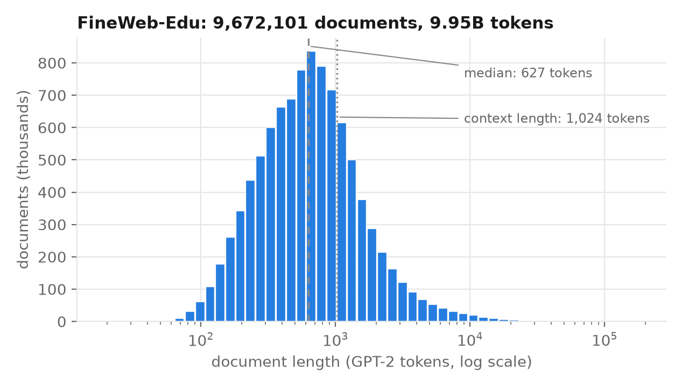
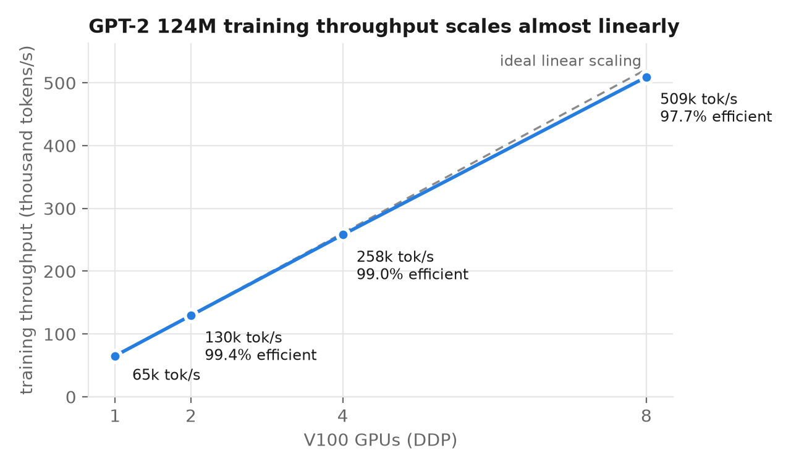
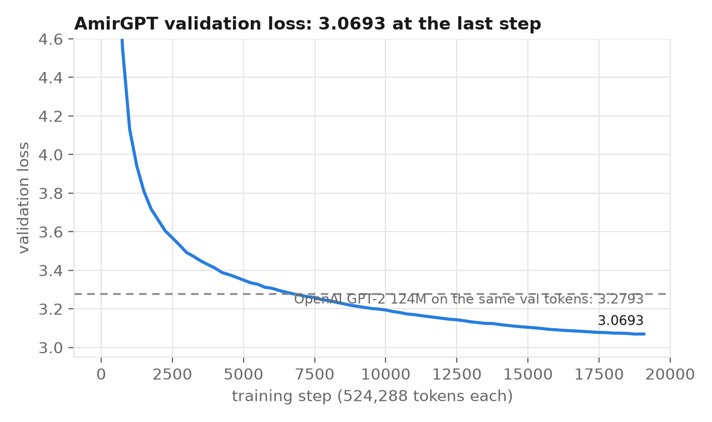
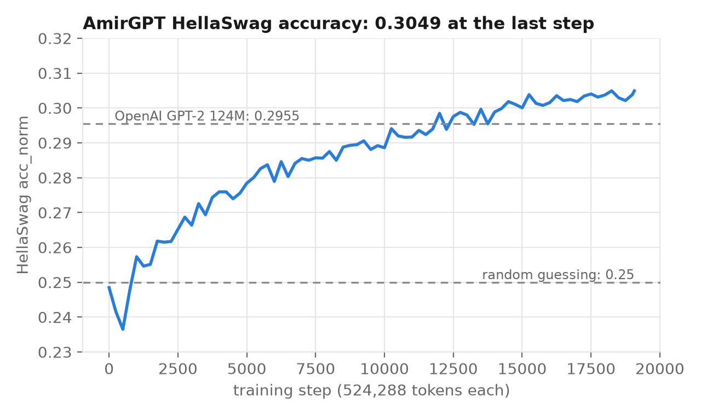

# AmirGPT: data and compute report

Big Data course project, Fall 2026. This report covers the data pipeline and the distributed
training behind AmirGPT, a GPT-2 (124M) model trained from scratch on about 10 billion tokens.
Every number here was measured on our own runs. The scripts that produced each one are named next to it.

## 1. Summary

| | |
|---|---|
| Raw data | FineWeb-Edu sample-10BT: 27 GB of Parquet, 9,672,101 documents |
| Training data | 9,953,989,344 GPT-2 tokens in 100 shards (19.9 GB as uint16) |
| Pipeline time | 22 min 18 s for download, verification and tokenization (one 24-CPU job) |
| Training | 19,073 steps × 524,288 tokens on 8× V100, 6 h 24 min, about 509k tokens/s |
| Scaling | 7.81× faster on 8 GPUs than on 1 (97.7% parallel efficiency) |
| Result | Val loss 3.0693 (OpenAI GPT-2: 3.2793), HellaSwag 0.3047 (OpenAI GPT-2: 0.2955) |
| Compute | about 51 V100-hours for pretraining, about 5 for chat fine-tuning |

## 2. Data pipeline

```
HuggingFace (Parquet, 27 GB)
   │  cluster/download_fineweb.sh: parallel HTTPS downloads, each file's size checked against the server
   ▼
raw_fineweb/*.parquet
   │  gpt2/fineweb.py: 22 worker processes, GPT-2 BPE (tiktoken), <|endoftext|> before every document
   ▼
edu_fineweb10B/edufineweb_{val,train}_NNNNNN.npy   100 shards × 100M tokens, uint16
   │  gpt2/data.py: memory-light shard loader; each DDP rank reads its own slice of the stream
   ▼
8 GPU processes
```

**Format.** GPT-2's vocabulary has 50,257 entries, so every token fits in 16 bits. Storing
tokens as `uint16` instead of `int32` halves disk and memory use: 9.95B tokens take 19.9 GB.
Tokenizing once and saving the result means the training job never sees raw text and never waits on the CPU.

**Downloading.** The HuggingFace client's default download path stalled at exactly 1,024,000,000 bytes
on the cluster. We replaced it with parallel `curl` downloads over HTTPS, and the script checks each
file's size against the server before tokenization starts.

**Splits.** Shard 0 (100M tokens) is the validation split; shards 1 to 99 (9.85B tokens) are the
training split. Every validation in this report uses the same first 10,485,760 validation tokens.

**Shuffling.** Karpathy's loader reads documents in the same order every epoch, and he suggests
permuting documents and shards ([3:50:05] in the video). Our loader does this. The permutations
come from (seed, epoch, shard), so all 8 GPUs see the same stream, and runs can be resumed exactly.

**What the documents look like** (`gpt2/data_stats.py`, every document counted):



| Statistic | Value |
|---|---|
| Documents | 9,672,101 |
| Mean length | 1,029 tokens |
| Median length (10th / 90th percentile) | 627 (211 / 1,918) tokens |
| 99th percentile | 7,667 tokens |
| Longest document | 168,038 tokens |

The median document is shorter than the model's 1,024-token context, so most training rows
contain several documents separated by `<|endoftext|>`. Long documents are cut across rows.
(Percentiles come from an evenly strided sample of about 2,000 documents per shard.)

## 3. Distributed training

**Data parallelism.** We use PyTorch DistributedDataParallel (DDP) on one node with 8 V100 32 GB GPUs.
Each GPU holds a full copy of the model and processes a different slice of the batch, and the
gradients are averaged across GPUs after every step.

**Batch size.** The video uses GPT-3's batch of 524,288 tokens (0.5M). One step is
32 sequences × 1,024 tokens × 8 GPUs × 2 gradient-accumulation micro-steps. During the first
micro-step, DDP skips the gradient synchronization (`no_sync`) because the second micro-step does it anyway.

**Precision.** V100s do not support bf16, which the video uses. We train in fp16 with dynamic loss scaling
(`GradScaler`). We also use `torch.compile`, which was 13% faster than eager mode in our
benchmark (492k vs 436k tokens/s at micro-batch 16).

**Scaling** (`cluster/bench_scaling.sbatch`; same model, batch and settings; median of steps 5 to 24):



| GPUs | Tokens/s | Speedup | Parallel efficiency |
|---|---|---|---|
| 1 | 65,190 | 1.00× | 100% |
| 2 | 129,572 | 1.99× | 99.4% |
| 4 | 258,096 | 3.96× | 99.0% |
| 8 | 509,297 | 7.81× | 97.7% |

At the 1-GPU rate, the 6 h 24 min run would have taken about 50 hours. Scaling is nearly linear
because each step does a lot of compute (524,288 tokens) relative to the one gradient
all-reduce per step (124M fp32 gradients, ≈ 500 MB), and all 8 GPUs are in the same machine.

**Fault tolerance.** Every 250 steps the job saves the model, optimizer, gradient scaler and
data-loader position and random-number state. Resubmitting the job continues exactly where it stopped.

**A problem we hit.** The first run stopped at step 250 with an out-of-memory error during the
first validation. The validation pass ran the full batch at once, outside the compiled
training graph, while the compiled graph's memory was still allocated. We split evaluation into
chunks of 8 sequences (the result is the same), freed cached memory before evaluating, and enabled
PyTorch's expandable memory segments. We tested the fix on a 45-step run before relaunching.

## 4. Results





The charts show the evaluations done during training (fp16, every 250 steps). The final numbers
below come from a separate fp32 run (`cluster/final_eval.sbatch`) on the last checkpoint.
That run evaluated our model and OpenAI GPT-2 with the same code and the same data:

| Metric | OpenAI GPT-2 124M | AmirGPT Base |
|---|---|---|
| Val loss (first 10,485,760 val tokens) | 3.2793 | **3.0693** |
| HellaSwag acc_norm (10,042 examples) | 0.2955 | **0.3047** |

AmirGPT's validation loss went below OpenAI GPT-2's at step 6,750, and its HellaSwag score
went above OpenAI GPT-2's at step 12,000. The loss comparison favours AmirGPT, because the
validation shard comes from the same dataset it was trained on; OpenAI trained GPT-2 on WebText.
HellaSwag is the fairer comparison. In the first few hundred steps HellaSwag drops slightly
below random guessing (0.2365 at step 500). At that point the model has learned only word
frequencies, and this is noise in the evaluation.

## 5. Chat fine-tuning data

| | Train | Validation |
|---|---|---|
| Conversations kept (smol-smoltalk + identity conversations) | 455,391 | 23,979 |
| Truncated to 1,024 tokens | 187,342 | 9,908 |
| Dropped (no assistant tokens left after truncation) | 5,950 | 300 |
| Tokens | 318,963,800 | 16,747,853 |
| Assistant tokens (the only ones the loss counts) | 256,013,095 | 13,445,005 |

The data was downloaded and tokenized in 3 min 42 s on 8 CPUs (`cluster/prep_sft.sbatch`).
Two epochs of training took 35 min 40 s on 8 GPUs, and the loss on held-out assistant tokens fell
from 2.456 to 1.351.

## 6. Compute used

| Job | Hardware | Wall clock | GPU-hours |
|---|---|---|---|
| Data download + tokenization | 24 CPUs | 22 min | – |
| Pretraining (19,073 steps) | 8× V100 | 6 h 24 min | 51.2 |
| Chat fine-tuning (2 epochs) | 8× V100 | 35 min 40 s | 4.8 |
| Preference tuning (DPO, experimental) | 8× V100 | 5 min 43 s | 0.8 |
| Final fp32 evaluation | 1× V100 | 9 min 55 s | 0.2 |
| Scaling benchmark | 8× V100 | 9 min 41 s | 1.3 |

## 7. Reproducing

Every figure in this report is regenerated from the logs and JSON files in the repo with
`.venv/bin/python docs/report/make_figures.py`. The cluster jobs are in `cluster/`, and the README
lists the order to run them.
